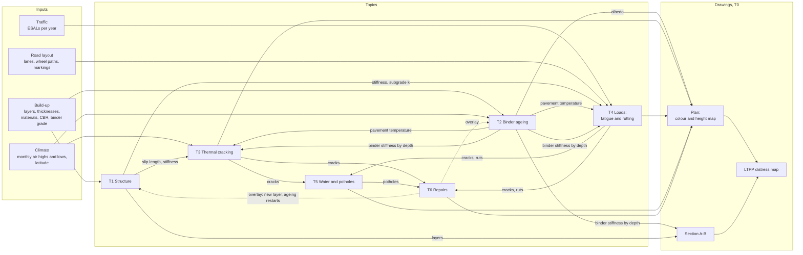
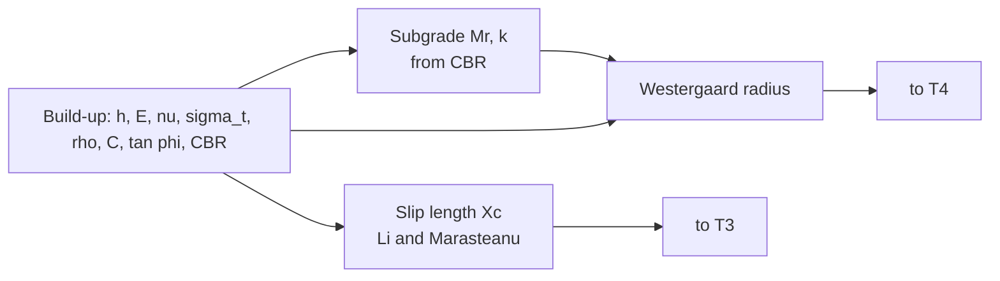
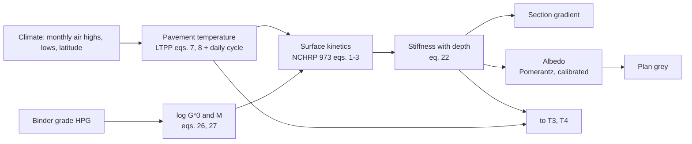
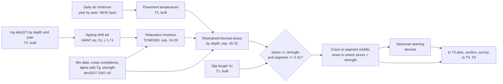

# Asphalt simulator: roadmap

**Every thread working on the asphalt simulator starts by reading this file and ends by updating it.** It shows
the topics, the order they come in, what each one takes in and gives out, its sources and where it stands. The
detail of each model (equations, constants, checks) lives in `docs/ASPHALT_SCIENCE.md`; papers are in
`References/Asphalt/` (see its README).

The goal (from ASPHALT_SCIENCE.md): **an accurate visual representation of an asphalt pavement as it ages, in plan
and in section.** The build-up, the climate and the traffic make one state through sourced equations; the plan,
the section and the distress map are drawn from that state.

## How the topics fit together

Inputs on the left, the topics in the middle, the drawings on the right. Each arrow is a named quantity in the
**shared quantities** table below; a topic may only use what arrives on an arrow.

The dotted arrows are the one loop: an overlay (T6) adds a layer to the build-up and starts a fresh surface
ageing, so the build-up is not fixed over time once repairs are in.

**Links deliberately left out** (so nobody adds them by accident):
- Albedo does not feed back into pavement temperature. Pomerantz 2000 measures about -4 C per +0.1 albedo, but
  the LTPP temperature model (FHWA-RD-97-103) was fitted to real, ageing pavements, so its average already
  contains the greying. Adding the feedback would count it twice.
- Cracks do not weaken the structure (T3/T4 back to T1) until T4 is written: MEPDG handles that through its
  damage sum, not by changing the layer moduli.

## Topics

Status: **Done**, **Current**, **Next**, **Later**, **Blocked**. Source status: **Read** (understood and used),
**In hand** (in References, not yet read for this topic), **Wanted** (not in References), **Gap** (no source
found yet).

### T0 Drawings and survey (cross-cutting): Done

What it does: turns the state into the LTPP drawings: the plan (colour and height map), the section A-B and the
LTPP distress map with its survey totals. It never makes damage; it only draws and measures what the topics made.

| Source | Status | Used for |
|---|---|---|
| LTPP Distress Identification Manual, FHWA-HRT-13-092 (2014) | Read | Distress definitions, severities, wheel paths (fig. 136), map symbols (figs. 137-138), data sheets |
| MUTCD (marking widths, broken-line pattern) | Read (values only, not filed) | Edge and centre lines |

Code: `asphalt_canvas.gd`, `cross_section_canvas.gd`, `distress_map_canvas.gd`, `asphalt_survey.gd`.
Checks: "LTPP survey keeps the manual's rules", "cross-section slices the road", "clicking the plan moves the
cut", "distress map view shows the survey".

### T1 Structure: Done (first pass)

What it does: from the build-up, works out how the pavement spreads stress: the slip length (spacing of
shrinkage cracks), the Westergaard radius (size of fatigue cells) and the subgrade support.

| Source | Status | Used for |
|---|---|---|
| c620 parking lot design guide, Table 3B (`References/Levels/c620content.pdf`) | Read | Baseline build-up: 3.0 in asphalt on 4.0 in aggregate, CBR 9 |
| Li & Marasteanu 2005, low-temperature crack spacing | Read | Slip length eq. 4; MnROAD material values (Table 4) |
| Mr = 2555 CBR^0.64 (MEPDG), k = Mr / 19.4 (AASHTO 1993) | Wanted (primary texts not read) | Subgrade support |
| Layered elastic analysis (Burmister; MEPDG) | Wanted | Replaces Westergaard when T4 starts |

Code: `pavement_layer.gd`, `pavement_buildup.gd`, `assets/asphalt/buildups/`, helpers in `asphalt_sim_state.gd`.
Check: "the build-up can be edited". Open item: the asphalt's warm modulus (3 GPa) has no citation; T2's binder
stiffness and NCHRP 973 chapter 6 should replace it.

### T2 Binder ageing: Current

What it does: hardens the binder year by year, fastest at the surface and in hot weather. In section: binder
stiffness drawn as a gradient through the asphalt. In plan: the surface greys (albedo rises).

| Source | Status | Used for |
|---|---|---|
| NCHRP 973 (Kim et al. 2021), ch. 2, 4, 5, Table 9 | Read | The Pavement Aging Model |
| NCHRP 871 (Kim et al. 2018), Table 16 | Read (that table) | Corrects 973's misprinted Af |
| FHWA-RD-97-103 (Mohseni 1998) | Read | Pavement temperature from air temperature |
| Pomerantz et al. 2000, LBNL-43442 | Read | Albedo against age, fig. 1 |
| NOAA 1991-2020 monthly normals (Burlington VT, Concord CA) | Data, collected | Climate input |
| NCHRP 973 ch. 6 (AMAC: binder to mixture) | In hand | Hands stiffness on to T3 and T4; read when T3 starts |
| TTI 0-6009-2 (Glover et al. 2014) | In hand | Background only; the model does not use it |
| FHWA-RD-98-087 Superpave summary (1998) | Read | Gradation limits and volumetrics for the surface composition (step 6b) |
| Pomerantz et al. 2000, Table 1 and p. 3 | Read | Binder 0.05, aggregates 0.10-0.28, chip seal 0.67 of aggregate, 15 / 85 % by volume (step 6b) |
| Mn/DOT 97-06 (1997), Tables 2.1 and 3.5: MnROAD mix and cell 18 as built | Read | Gradation, volumetrics and rock types of the surface (step 6b) |
| Mn/ROAD aggregate profile (1996), Table 1 | In hand | Base gradation (Class 6sp), for the section's base later |
| LTPP AG04 gradation for the section | Wanted (InfoPave) | Replaces cell 18's when the section is verified |
| TRR 2676 (2022), albedo change mechanism (abstract) | Read | Oxidation leaves albedo at 0.05; abrasion exposes aggregate (step 6b) |
| NCAT 19-09 (2019), Quantifying Pavement Albedo | Read (model, ch. on asphalt) | Albedo against age and aggregate grayscale, field (step 6b) |
| FHWA-HRT-25-100 (2025) macrotexture TechBrief; VTRC 23-R15 (2023) | Read | MPD target for the packed surface: 0.35 mm predicted, 0.39-0.49 measured (step 6b) |
| FHWA AIMS2 HIF-11-030 (aggregate shape) | Wanted (FHWA page erroring) | Stone shapes (step 6b) |
| Xu et al. 2010, polyhedral aggregate generation and packing | Read | Stone shapes and packing (step 6b; prototype `docs/asphalt_checks/stone_packing.py`: 38.5 % stone against the mix's 38.1 %) |
| Herold & Roberts 2005, spectral ageing of asphalt roads | Read | What ageing, cracks, ravelling and repairs do to reflectance (step 6b) |
| Physics-engine / DEM packing of asphalt (Wan et al.) | Not needed for the bulk | The stones float in the mastic at 38 %; random packing guided by a free-space map reaches it |
| Mastic level at the surface; stone orientation under compaction | Wanted | Makes MPD a check instead of a calibration (step 6b) |
| RVE size of asphalt (Romero & Masad 2001; Kim et al. 2009) | Wanted (summaries read: 50-60 mm for dense-graded) | Tile size; our 50 vs 100 mm check agrees (step 6b) |
| Wang / corner tiles (Cohen et al. 2003; Lagae & Dutré) | Wanted (summaries read) | Tiling the road from a few packed tiles without repeats (step 6b) |
| Surface wear rate under traffic | Wanted | Wear depth against time and traffic, for the exposure (step 6b, then T4) |

Steps (one commit each, each with its own check):
- [x] Model written up for review (ASPHALT_SCIENCE.md, Model 1)
- [x] Whole chain checked in Python (`docs/asphalt_checks/binder_ageing_chain.py`)
- [x] 1. Climate resource with the NOAA normals and latitude (`SiteClimate`, `assets/asphalt/climates/`; check "climate holds the NOAA normals")
- [x] 2. Pavement temperature: reproduces the Python chain's hours above 20 C (`PavementTemperature`; Burlington 4,399 h, Concord 5,600 h, -8.4 to 50.0 C and 4.9 to 53.8 C at the surface; checks "LTPP pavement temperature equations", "pavement temperature matches the chain")
- [x] 3. Surface kinetics and depth: reproduces the chain table (`BinderAgeing`; Burlington surface 0.96 / 1.75 / 2.47 at 1 / 5 / 10 years, Concord 1.05 / 1.97 / 2.74; checks "NCHRP 973 kinetics constants", "binder ageing matches the chain", "binder hardens with age, most at the surface", "a hotter climate ages the binder faster")
- [x] 4. Binder grade on the build-up; inputs from HPG (PG 64: 0.72, 0.832) (`PavementLayer.binder_hpg`, 64 on the c620 preset; `BinderAgeing.unaged_log_g()`, `susceptibility()`, `for_layer()`; check "binder grade sets the ageing inputs"; lab box added in step 5)
- [x] 5. Section draws the stiffness gradient (`CrossSectionCanvas`: asphalt shaded paper to grey from unaged binder to log abs(G*) 4.5, 24 bands, under the stipple; PG and top/bottom log abs(G*) in the layer label. The sim takes a `site_climate` (Burlington by default) and caches `binder()` per climate and grade, aged by `surface_age()`, so a placeholder overlay restarts it. Lab: Binder grade PG box. Check "the section's stiffness gradient is the model's")
- [ ] 6. Plan grey from albedo. **Reopened (zack, Nov 27):** the first version greyed a ChatGPT photo and scaled it with two constants measured off our own render; neither is data. Now: `BinderAgeing.albedo()` (a_fresh 0.04, a_limit 0.13, p0 0.15, Pomerantz fig. 1) and `AsphaltSim.albedo()`; with `placeholders` off the plan is drawn **flat** at the albedo as a linear reflectance (white paper = 1), no texture. Checks "albedo follows Pomerantz", "the plan is drawn at the model's albedo". Next: the surface made of what it is made of (6b)
- [ ] 6b. Surface composition: **written up for review (ASPHALT_SCIENCE.md, Model 1b, with a second pass: wear not oxidation drives the albedo, Jolt packing of low-poly stones, macrotexture from the stones checked against MPD) and checked in Python (`docs/asphalt_checks/surface_composition.py`); waiting for zack's review before code.** Mix: MnROAD cell 18 wear course (Mn/DOT 97-06). Original note: binder (0.05) and exposed aggregate (its measured albedo, Pomerantz Table 1: 0.10-0.28) drawn as stones; exposed fraction from the surface ageing up to the chip-seal ceiling (0.67 +- 0.11 of the aggregate's albedo); stone sizes from the gradation, area fraction from the volume fraction (Delesse). The mean albedo then comes out of the picture and becomes a check. Gradation limits in hand: FHWA-RD-98-087 (12.5 mm control points, restricted zone, VMA 14 %, air voids 4 %); an actual curve wanted: LTPP AG04 for the section (InfoPave), or MnROAD cell 18's job-mix formula (AC-20 = PG 64-22, the build-up's strength source; MnDOT library host blocked from this session). Aggregate albedo: Pomerantz Table 1 for now (option A, zack). Gaps: binder lightening with oxidation; aggregate weathering (rock oxidises too: iron staining, feldspar to clay); aggregate shape. The section must draw the same stones: one 3D stone field that the plan (z = 0) and the section (the cut) both slice, so scrubbing the cut moves through it
- [ ] 7. Roadmap and science register updated

### T3 Thermal cracking: Current (research; Model 2 checked in Python, waiting for zack's review)

What it does: in cold weather the aged, stiffer layer shrinks, the base holds it back and it cracks across the
road where the restrained stress reaches the mix's strength, at a spacing set by the slip length. Places the
transverse cracks, their depth and their seasonal opening. Model: ASPHALT_SCIENCE.md, Model 2.

| Source | Status | Used for |
|---|---|---|
| Li & Marasteanu 2005 | Read (for T3) | Strength criterion; slip length eq. 4; spacing 1.5 Xc; Jones alpha eq. 3; MnROAD spacings; TCMODEL predicted none there |
| Chen et al. 2022 | Read (for T3) | Halving: mean spacing 3/4 of the largest (= Li's 1.5 Xc, derived); measured asphalt alpha 15-22 x 10^-6/C |
| Bohn et al. 2005; Shorlin et al. 1999 | Read (for T3) | New crack near a domain's middle; 90 deg junctions; spacing proportional to thickness |
| Mn/DOT 2007-43 (Marasteanu et al.), low-temperature cracking pooled fund | Read (ch. 2, 3-6, 9); filed this thread | TCMODEL as implemented (eqs. 22-40); PG 64-22 mix data (creep, strength, dilatometric alpha, TSRST); MnROAD cores; TCMODEL against field (Table 9.1) |
| MassDOT 24-067 (Von Quintus et al. 2024) | Read (ch. 5.1); filed | Current TC equations; 2018 calibration kt = 3e-7 MAAT^4.0317 |
| NCHRP 973 ch. 6 (AMAC) | Read | Binder log abs(G*) change to the mix's modulus master curve shift (eq. 51). **Gives modulus and fatigue, not strength** (corrected) |
| FHWA-HRT-16-084 (2019) | Read (ch. 1); filed | Mechanisms; widths grow over time (no rate) |
| NCHRP 1-37A Appendix HH (TCMODEL calibration, level 3 correlations); Part 3 ch. 3 | Wanted: trb.org blocked from this session | Primary text of TCMODEL; for zack to file |
| AASHTO MEPDG Manual of Practice, 2008 interim edition (`AASHTO08.pdf`, zack) | Read (5.2.4) | TCMODEL equations from the primary text; kt by input level |
| NRC Canada RR-216 (Ali 2005); Maryland SHA vol. 2 (Schwartz & Carvalho 2007) (zack) | Read (TC sections) | TC amount is ft per 500 ft, at most 200 of 400; TCMODEL does not age the mix |
| Hiltunen & Roque 1994; Jones et al. 1968 (AAPT) | Wanted (paywalled) | Originals of TCMODEL and of alpha's volumetric estimate |
| Thermal contraction coefficient of the mix | **Sourced** (was Gap): measured, Mn/DOT 2007-43 Tables 6.19, 6.22 | Thermal stress |
| Crack width growth over the years | Gap (Alaska AK-RD-86-26 host refused; LTPP surveys in InfoPave, blocked) | LTPP severity (L/M/H by width) |
| Block cracking | Gap: the criterion predicts no longitudinal crack inside a 3.65 m lane (needs 2 Xc = 5.4 m) | Block cracks |

New quantities Model 2 needs (proposed; to agree in the hub before any code, then added to the shared table):

| Quantity | Unit | Made by | Note |
|---|---|---|---|
| Daily air minimum, year by year | C | Input (climate) | NOAA GHCN-Daily for the site; the normals never crack anything |
| Mix contraction: Tg, alpha_g, alpha_l | C, 1/C | Input (asphalt layer) | Mn/DOT 2007-43 |
| Mix creep compliance master curve (unaged) and its aT | 1/Pa, - | Input (asphalt layer) | Mn/DOT 2007-43 Table 6.5 |
| Mix low-temperature strength sigma_t and its scatter | Pa, - | Input (asphalt layer) | Replaces the build-up's 2.27 MPa, which T1's slip length uses: one owner |
| Ageing shift aA(z, year) | - | T3 (AMAC) | From `BinderAgeing.log_g()` |
| Thermal stress sigma(z, t) | Pa | T3 | |

Steps (one commit each; stop for zack's review where marked):
- [x] Sources read and filed; Model 2 written up (ASPHALT_SCIENCE.md) **-> zack's review**
- [x] Decisions (zack): daily climate = Burlington GHCN-Daily 1991-2020 (`docs/asphalt_checks/data/`); strength =
  TSRST 2.92 MPa
- [x] Whole chain checked in Python (`docs/asphalt_checks/thermal_cracking_chain.py`; results in Model 2). Passes:
  master curve, Soules recursion, Li's Table 4, halving (1.35 Xc), the ageing / colder / thicker trends, MnROAD's
  cracks in winter 1995-96. **Fails: TSRST with the measured alpha (-20.7 against -25.9 C); AMAC over-hardens at
  low temperature against aged MnROAD cores.** Also: all cracks in one winter, half the field's scatter, few
  full-depth cracks. TCMODEL amount deferred (needs Appendix HH) **-> zack's review: choose the options in Model 2**
- [ ] 1. Daily climate input and the new layer inputs (shared table rows agreed in the hub first)
- [ ] 2. Relaxation modulus with the AMAC shift, by depth and year (own file)
- [ ] 3. Restrained thermal stress through the winter, by depth (own file)
- [ ] 4. Initiation and halving: cracks placed in the sim, with depth
- [ ] 5. Drawn: plan, section, distress map; seasonal opening
- [ ] 6. Checks between topics (thicker layer, aged binder, colder climate)
- [ ] 7. Roadmap and science register updated

### T4 Loads: fatigue cracking and rutting: Current (research)

What it does: repeated axle loads bend the layer; damage adds up (Miner's rule) until the wheel paths crack into
crocodile cells; the layers also deform permanently (ruts). Rutting sits here, not in T5, because the same
layered analysis drives both.

| Source | Status | Used for |
|---|---|---|
| MEPDG bottom-up fatigue and rutting models (NCHRP 1-37A, AASHTO Manual of Practice) | Wanted | Damage, area cracked, rut depth per layer |
| Layered elastic analysis | Wanted | Strain under the wheel |
| Traffic: c620 Table 5 ESALs; later the LTPP section's traffic | In hand (c620) | Load repetitions |
| MEPDG lateral wander | Wanted | Spread of load across the wheel path |
| LTPP DIM (fatigue cells under 0.3 m; rut by 1.2 m straightedge) | Read | Checks |

### T5 Water and potholes: Later

What it does: water gets in through cracks, the cracked areas break up and potholes form and deepen.

| Source | Status | Used for |
|---|---|---|
| LTPP DIM (pothole size and depth classes, pumping) | Read | Definitions and checks |
| A model of pothole formation and growth | Gap | Everything else. The weakest-sourced topic; may have to be data-driven from LTPP surveys |

### T6 Repairs: Later

What it does: crack sealing, patching and overlays. An overlay adds a layer to the build-up and restarts T2 for
the new surface.

| Source | Status | Used for |
|---|---|---|
| LTPP DIM (patch definitions, sealant condition) | Read | Definitions and checks |
| LTPP SPS-3 and SPS-5 (maintenance and rehabilitation experiments) | Wanted | How long each repair lasts |

### V Checking against a real LTPP section: Blocked

What it does: runs the simulator with a real section's build-up, climate and traffic and compares the result with
its yearly distress surveys. Shortlist (unverified): 50-1002 Vermont (best documented), 56-1007 Wyoming, 83-1801
Manitoba. Blocked: InfoPave down for maintenance (Nov 27 2026). Research only: a side thread can do it at any time
without touching the code.

### G Back into the game: Later

Bake the 3D sections and lots (`asphalt_section.tscn`, `asphalt_lot.tscn`, `lot90.tscn`) from the sourced models
instead of the placeholders. Until then the game keeps `placeholders` on and is unchanged.

## Shared quantities

Each quantity has one name, one unit and one owner. A topic that needs a new quantity adds a row here **before**
writing the code, and the owner's file is the only one that computes it. Units in the simulator are SI; feet
appear only on the distress map's second axis.

| Quantity | Unit | Made by | Used by | Where (planned for those not built) | Status |
|---|---|---|---|---|---|
| Layers: thickness h, modulus E, Poisson nu, density rho, cold tensile strength sigma_t | m, Pa, -, kg/m3, Pa | Input (build-up) | T1, T3, T4, T0 section | `PavementBuildup`, `PavementLayer` | Built |
| Base cohesion C, friction tan phi | Pa, - | Input | T1 | `PavementLayer` | Built |
| Subgrade CBR; Mr; k | -, Pa, Pa/m | Input; T1 | T1, T4 | `PavementBuildup.subgrade_mr()`, `subgrade_k()` | Built |
| Binder high grade HPG | C | Input (asphalt layer) | T2 | `PavementLayer.binder_hpg` | Built |
| Road layout: lanes, wheel paths, markings | m | Input | T4, T0 | `AsphaltSim` exports | Built |
| Monthly air high and low, latitude | C, degrees | Input (climate) | T2, T3 | `SiteClimate` (stored in F as NOAA publishes); the sim's `site_climate` | Built |
| Pavement temperature T(depth, hour) | C | T2 | T2, T3, T4 | `PavementTemperature` | Built |
| Binder stiffness log abs(G*)(depth, year) | log kPa (64 C, 10 rad/s) | T2 | T3, T4 (through AMAC), T0 section | `BinderAgeing.log_g()` | Built |
| Surface ageing p | - (0 to 1) | T2 | T2 albedo | `BinderAgeing.surface_progress()` | Built |
| Albedo | - (0 to 1) | T2 | T0 plan | `BinderAgeing.albedo()`, `AsphaltSim.albedo()` | Built (drawn flat; composition in 6b) |
| Slip length Xc | m | T1 | T3 | `AsphaltSimState.slip_length()` | Built |
| Westergaard radius (wheel spread) | m | T1 | T4 | `AsphaltSimState.wheel_spread()` | Built; replaced in T4 |
| Mixture modulus (from binder stiffness; AMAC gives no strength, see T3) | Pa | T3/T4, via AMAC | T3, T4 | not decided | T3 |
| Traffic: ESALs per year, lateral wander | -, m | Input | T4 | not decided | T4 |
| Cracks: path, type, width, depth | m | T3, T4 | T5, T6, T0 | `AsphaltSim.cracks` | Built (geometry); widths and depths still placeholders |
| Rut depth across the road | m | T4 | T0, T6 | not decided | T4 |
| Potholes: position, size, depth | m | T5 | T6, T0 | `AsphaltSim` | Placeholder |
| Repairs: patches, seals, overlays | m, year | T6 | T1, T2 (overlay), T0 | `asphalt_sim_repairs.gd` | Placeholder |

## Checks between topics

The tests in `tests/asphalt_test.gd` check each topic against its source. These check the links; each is written
as soon as both of its topics exist.

| Check | Topics | Status |
|---|---|---|
| Plan and section agree: every crack crossing the cut appears in the section, the section's rut equals the height map's | T0 | Built |
| With `placeholders` off nothing without a source is drawn | all | Built ("the lab shows only sourced models") |
| A hotter climate ages the binder faster | T2 | Built |
| The section's stiffness gradient is the model's, layer by layer | T2, T0 | Built |
| A thicker asphalt layer gives a longer slip length and wider crack spacing | T1, T3 | T3 |
| A more aged (stiffer) binder cracks sooner in the cold | T2, T3 | T3 |
| A colder climate gives more thermal cracks | T2, T3 | T3 |
| A thicker structure gives less fatigue and less rutting; more ESALs give more | T1, T4 | T4 |
| Potholes form only where there are cracks | T3/T4, T5 | T5 |
| An overlay adds a layer, resets the albedo to fresh and restarts the ageing | T6, T1, T2 | T6 |

## Data to collect

| Data | For | Source | Status |
|---|---|---|---|
| Monthly normals (air highs and lows) for the default site | T2, T3 | NOAA 1991-2020 normals | Collected (Burlington, Concord), in `binder_ageing_chain.py` |
| Binder grade of the default road | T2 | PG 64-22 (chosen with zack; LTPP section's when verified) | Chosen; on the c620 preset |
| Traffic for the default road | T4 | c620 Table 5; then the LTPP section | Not yet |
| LTPP section: build-up, climate, traffic, yearly surveys | V | InfoPave | Blocked |
| Mix thermal contraction coefficient | T3 | Mn/DOT 2007-43 dilatometry (PG 64-22 lab mix; MnROAD cell 19 core) | Collected (in Model 2) |
| Daily air minimum, year by year, for the default site | T3 | NOAA GHCN-Daily | Not yet |

## Threads and branches

Threads are grouped under the **Asphalt simulator** thread, like the cart's. Each is named after its topic, and so
is its git branch:

| Thread | Branch | Status |
|---|---|---|
| Asphalt simulator (the hub: roadmap, planning, reviews) | `claude/focused-hamilton-r9x9hq` (made before this rule) | Open |
| Asphalt T2: binder ageing | `asphalt/t2-binder-ageing` | Open |
| Asphalt T3: thermal cracking | `asphalt/t3-thermal-cracking` | Open (started before T2 finished, see below) |
| Asphalt T4: loads (fatigue and rutting) | `asphalt/t4-loads` | Open (research, alongside T3) |
| Asphalt V: LTPP section check | `asphalt/v-ltpp-section` | Waiting for InfoPave |

Later topics follow the same pattern (`Asphalt T5: water and potholes` on `asphalt/t5-water-potholes`, and so on). Normally a topic's branch
is merged before the next topic's thread starts.

**T2 and T3 overlap (zack, Nov 27).** T3 started while T2 was finishing step 6b, because everything T3 takes from T2
is built: pavement temperature (`PavementTemperature`) and binder stiffness by depth (`BinderAgeing.log_g()`). Step
6b is the surface's look in plan, which T3 doesn't use. To keep the two from colliding:
- T3 reads and writes up first (sources, Model 2 in ASPHALT_SCIENCE.md, a Python check), touching only the docs.
- When T3 codes, it puts its model in its own new files, its checks in their own function in `asphalt_test.gd`, and
  edits only its own sections of the docs. It doesn't change `BinderAgeing`, `PavementTemperature` or the surface
  drawing; if it needs something new from T2, that is a new row in the shared quantities table, agreed in the hub.
- Both merge the hub branch before each push.

**T4 alongside T3 (zack, Nov 27).** T4 started in research while T3 was in review, on the same rules as T3 (docs
first; own files and own test function when it codes; nothing of T2's changed). T3 and T4 share one thing: the mix's
modulus from the aged binder (NCHRP 973 AMAC, eq. 51, written up in Model 2). **One owner computes it**: T4 uses
Model 2's write-up and doesn't derive its own; the hub decides which thread codes the shared file before either
codes it. T4 adds traffic, wander and rut depth to the shared quantities table only through the hub.

## How we work

- **One coding thread at a time** on the simulator, the lab and the tests, in topic order: each topic uses what the
  one before it gives out. **Side threads only research** (read papers, collect data, write notes in the docs);
  they don't edit the code.
- **A topic goes:** read its sources -> write the model in ASPHALT_SCIENCE.md for review -> check it in Python
  against the papers' numbers -> code it in its own file with tests -> draw it -> write the checks between topics
  -> update this file.
- **A new quantity goes in the shared quantities table first.**
- **Start of a thread:** read this file, then the topic's part of ASPHALT_SCIENCE.md. **End of a thread:** tick the
  steps done, update the statuses and the commit log below, push.

## Log

| Date | Topic | What | Commit |
|---|---|---|---|
| Nov 26 2026 | T0 | LTPP survey, distress map, cross-section | see DEV_NOTES |
| Nov 27 2026 | T0, T1 | Two-lane road, paper style, editable build-up, sim split, placeholders out of the lab | see DEV_NOTES |
| Nov 27 2026 | T2 | Ageing model written up; chain checked in Python | 095bfbf |
| Nov 27 2026 | all | This roadmap | 4621cd9 |
| Nov 27 2026 | T2 | Steps 1-2: climate table, pavement temperature | e9e64ca |
| Nov 27 2026 | T2 | Step 3: surface kinetics and depth (`BinderAgeing`) | a4a8d82 |
| Nov 27 2026 | T2 | Step 4: binder grade on the build-up, inputs from HPG | 9d2391a |
| Nov 27 2026 | T2 | Step 5: section draws the stiffness gradient | ef9dad2, e4303ad |
| Nov 27 2026 | T2 | Step 6: plan grey from albedo | 13dba8d |
| Nov 27 2026 | T2 | Step 6 reopened: photo and scaling out, plan flat at the albedo | this commit |
| Nov 27 2026 | T3 | Sources read and filed; Model 2 (thermal cracking) written up for review | 67ba5ea |
| Nov 27 2026 | T3 | Decisions recorded; chain checked in Python (two inputs fail; options in Model 2) | this commit |
