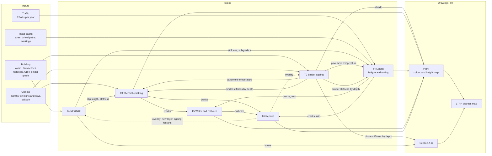
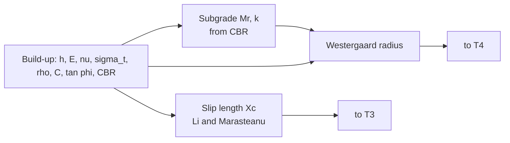
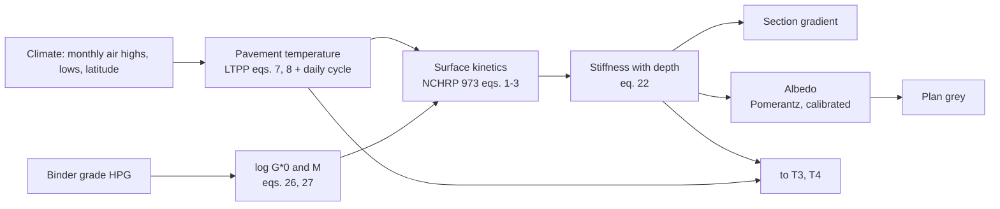

# Asphalt simulator: roadmap

**Every thread working on the asphalt simulator starts by reading this file and ends by updating it.** It shows
the topics, the order they come in, what each one takes in and gives out, its sources and where it stands. The
detail of each model (equations, constants, checks) lives in `docs/ASPHALT_SCIENCE.md`; papers are in
`References/Asphalt/` (see its README).

The goal (from ASPHALT_SCIENCE.md): **an accurate visual representation of an asphalt pavement as it ages, in plan
and in section.** The build-up, the climate and the traffic make one state through sourced equations; the plan,
the section and the distress map are drawn from that state.

## How the topics fit together

Inputs on the left, the topics in the middle, the drawings on the right. Each arrow is a named quantity in the
**shared quantities** table below; a topic may only use what arrives on an arrow.

The dotted arrows are the one loop: an overlay (T6) adds a layer to the build-up and starts a fresh surface
ageing, so the build-up is not fixed over time once repairs are in.

**Links deliberately left out** (so nobody adds them by accident):
- Albedo does not feed back into pavement temperature. Pomerantz 2000 measures about -4 C per +0.1 albedo, but
  the LTPP temperature model (FHWA-RD-97-103) was fitted to real, ageing pavements, so its average already
  contains the greying. Adding the feedback would count it twice.
- Cracks do not weaken the structure (T3/T4 back to T1) until T4 is written: MEPDG handles that through its
  damage sum, not by changing the layer moduli.

## Topics

Status: **Done**, **Current**, **Next**, **Later**, **Blocked**. Source status: **Read** (understood and used),
**In hand** (in References, not yet read for this topic), **Wanted** (not in References), **Gap** (no source
found yet).

### T0 Drawings and survey (cross-cutting): Done

What it does: turns the state into the LTPP drawings: the plan (colour and height map), the section A-B and the
LTPP distress map with its survey totals. It never makes damage; it only draws and measures what the topics made.

| Source | Status | Used for |
|---|---|---|
| LTPP Distress Identification Manual, FHWA-HRT-13-092 (2014) | Read | Distress definitions, severities, wheel paths (fig. 136), map symbols (figs. 137-138), data sheets |
| MUTCD (marking widths, broken-line pattern) | Read (values only, not filed) | Edge and centre lines |

Code: `asphalt_canvas.gd`, `cross_section_canvas.gd`, `distress_map_canvas.gd`, `asphalt_survey.gd`.
Checks: "LTPP survey keeps the manual's rules", "cross-section slices the road", "clicking the plan moves the
cut", "distress map view shows the survey".

### T1 Structure: Done (first pass)

What it does: from the build-up, works out how the pavement spreads stress: the slip length (spacing of
shrinkage cracks), the Westergaard radius (size of fatigue cells) and the subgrade support.

| Source | Status | Used for |
|---|---|---|
| c620 parking lot design guide, Table 3B (`References/Levels/c620content.pdf`) | Read | Baseline build-up: 3.0 in asphalt on 4.0 in aggregate, CBR 9 |
| Li & Marasteanu 2005, low-temperature crack spacing | Read | Slip length eq. 4; MnROAD material values (Table 4) |
| Mr = 2555 CBR^0.64 (MEPDG), k = Mr / 19.4 (AASHTO 1993) | Wanted (primary texts not read) | Subgrade support |
| Layered elastic analysis (Burmister; MEPDG) | Wanted | Replaces Westergaard when T4 starts |

Code: `pavement_layer.gd`, `pavement_buildup.gd`, `assets/asphalt/buildups/`, helpers in `asphalt_sim_state.gd`.
Check: "the build-up can be edited". Open item: the asphalt's warm modulus (3 GPa) has no citation; T2's binder
stiffness and NCHRP 973 chapter 6 should replace it.

### T2 Binder ageing: Current

What it does: hardens the binder year by year, fastest at the surface and in hot weather. In section: binder
stiffness drawn as a gradient through the asphalt. In plan: the surface greys (albedo rises).

| Source | Status | Used for |
|---|---|---|
| NCHRP 973 (Kim et al. 2021), ch. 2, 4, 5, Table 9 | Read | The Pavement Aging Model |
| NCHRP 871 (Kim et al. 2018), Table 16 | Read (that table) | Corrects 973's misprinted Af |
| FHWA-RD-97-103 (Mohseni 1998) | Read | Pavement temperature from air temperature |
| Pomerantz et al. 2000, LBNL-43442 | Read | Albedo against age, fig. 1 |
| NOAA 1991-2020 monthly normals (Burlington VT, Concord CA) | Data, collected | Climate input |
| NCHRP 973 ch. 6 (AMAC: binder to mixture) | In hand | Hands stiffness on to T3 and T4; read when T3 starts |
| TTI 0-6009-2 (Glover et al. 2014) | In hand | Background only; the model does not use it |

Steps (one commit each, each with its own check):
- [x] Model written up for review (ASPHALT_SCIENCE.md, Model 1)
- [x] Whole chain checked in Python (`docs/asphalt_checks/binder_ageing_chain.py`)
- [ ] 1. Climate resource with the NOAA normals and latitude
- [ ] 2. Pavement temperature: reproduces the Python chain's hours above 20 C
- [ ] 3. Surface kinetics and depth: reproduces the chain table (Burlington surface 0.96 / 1.75 / 2.47 at 1 / 5 / 10 years)
- [ ] 4. Binder grade on the build-up; inputs from HPG (PG 64: 0.72, 0.832)
- [ ] 5. Section draws the stiffness gradient
- [ ] 6. Plan grey from albedo
- [ ] 7. Roadmap and science register updated

### T3 Thermal cracking: Next

What it does: in cold weather the aged, stiffer layer shrinks, the base holds it back and it cracks across the
road, at a spacing set by the slip length; later the transverse cracks join into blocks. Places and grows the
transverse and block cracks (and their widths, for the LTPP severity).

| Source | Status | Used for |
|---|---|---|
| Li & Marasteanu 2005 | Read | Crack spacing from the slip length |
| Chen et al. 2022 | Read | Spacing halves as cracks are added |
| Bohn et al. 2005; Shorlin et al. 1999 | Read | How cracks run and meet (90 degrees) |
| MEPDG thermal cracking model (TCMODEL, NCHRP 1-37A) | Wanted | When cracking starts and how much |
| NCHRP 973 ch. 6 (AMAC) | In hand | Binder stiffness to the mix's creep and strength |
| Thermal contraction coefficient of the mix | Gap | Thermal stress |
| Crack width growth over the years | Gap | LTPP severity (L/M/H by width) |

### T4 Loads: fatigue cracking and rutting: Later

What it does: repeated axle loads bend the layer; damage adds up (Miner's rule) until the wheel paths crack into
crocodile cells; the layers also deform permanently (ruts). Rutting sits here, not in T5, because the same
layered analysis drives both.

| Source | Status | Used for |
|---|---|---|
| MEPDG bottom-up fatigue and rutting models (NCHRP 1-37A, AASHTO Manual of Practice) | Wanted | Damage, area cracked, rut depth per layer |
| Layered elastic analysis | Wanted | Strain under the wheel |
| Traffic: c620 Table 5 ESALs; later the LTPP section's traffic | In hand (c620) | Load repetitions |
| MEPDG lateral wander | Wanted | Spread of load across the wheel path |
| LTPP DIM (fatigue cells under 0.3 m; rut by 1.2 m straightedge) | Read | Checks |

### T5 Water and potholes: Later

What it does: water gets in through cracks, the cracked areas break up and potholes form and deepen.

| Source | Status | Used for |
|---|---|---|
| LTPP DIM (pothole size and depth classes, pumping) | Read | Definitions and checks |
| A model of pothole formation and growth | Gap | Everything else. The weakest-sourced topic; may have to be data-driven from LTPP surveys |

### T6 Repairs: Later

What it does: crack sealing, patching and overlays. An overlay adds a layer to the build-up and restarts T2 for
the new surface.

| Source | Status | Used for |
|---|---|---|
| LTPP DIM (patch definitions, sealant condition) | Read | Definitions and checks |
| LTPP SPS-3 and SPS-5 (maintenance and rehabilitation experiments) | Wanted | How long each repair lasts |

### V Checking against a real LTPP section: Blocked

What it does: runs the simulator with a real section's build-up, climate and traffic and compares the result with
its yearly distress surveys. Shortlist (unverified): 50-1002 Vermont (best documented), 56-1007 Wyoming, 83-1801
Manitoba. Blocked: InfoPave down for maintenance (Nov 27 2026). Research only: a side thread can do it at any time
without touching the code.

### G Back into the game: Later

Bake the 3D sections and lots (`asphalt_section.tscn`, `asphalt_lot.tscn`, `lot90.tscn`) from the sourced models
instead of the placeholders. Until then the game keeps `placeholders` on and is unchanged.

## Shared quantities

Each quantity has one name, one unit and one owner. A topic that needs a new quantity adds a row here **before**
writing the code, and the owner's file is the only one that computes it. Units in the simulator are SI; feet
appear only on the distress map's second axis.

| Quantity | Unit | Made by | Used by | Where (planned for those not built) | Status |
|---|---|---|---|---|---|
| Layers: thickness h, modulus E, Poisson nu, density rho, cold tensile strength sigma_t | m, Pa, -, kg/m3, Pa | Input (build-up) | T1, T3, T4, T0 section | `PavementBuildup`, `PavementLayer` | Built |
| Base cohesion C, friction tan phi | Pa, - | Input | T1 | `PavementLayer` | Built |
| Subgrade CBR; Mr; k | -, Pa, Pa/m | Input; T1 | T1, T4 | `PavementBuildup.subgrade_mr()`, `subgrade_k()` | Built |
| Binder high grade HPG | C | Input (asphalt layer) | T2 | `PavementLayer` | T2 step 4 |
| Road layout: lanes, wheel paths, markings | m | Input | T4, T0 | `AsphaltSim` exports | Built |
| Monthly air high and low, latitude | C, degrees | Input (climate) | T2, T3 | Climate resource | T2 step 1 |
| Pavement temperature T(depth, hour) | C | T2 | T2, T3, T4 | `pavement_temperature.gd` | T2 step 2 |
| Binder stiffness log abs(G*)(depth, year) | log kPa (64 C, 10 rad/s) | T2 | T3, T4 (through AMAC), T0 section | `binder_ageing.gd` | T2 step 3 |
| Surface ageing p | - (0 to 1) | T2 | T2 albedo | `binder_ageing.gd` | T2 step 3 |
| Albedo | - (0 to 1) | T2 | T0 plan | `binder_ageing.gd` | T2 step 6 |
| Slip length Xc | m | T1 | T3 | `AsphaltSimState.slip_length()` | Built |
| Westergaard radius (wheel spread) | m | T1 | T4 | `AsphaltSimState.wheel_spread()` | Built; replaced in T4 |
| Mixture modulus and strength (from binder stiffness) | Pa | T3/T4, via AMAC | T3, T4 | not decided | T3 |
| Traffic: ESALs per year, lateral wander | -, m | Input | T4 | not decided | T4 |
| Cracks: path, type, width, depth | m | T3, T4 | T5, T6, T0 | `AsphaltSim.cracks` | Built (geometry); widths and depths still placeholders |
| Rut depth across the road | m | T4 | T0, T6 | not decided | T4 |
| Potholes: position, size, depth | m | T5 | T6, T0 | `AsphaltSim` | Placeholder |
| Repairs: patches, seals, overlays | m, year | T6 | T1, T2 (overlay), T0 | `asphalt_sim_repairs.gd` | Placeholder |

## Checks between topics

The tests in `tests/asphalt_test.gd` check each topic against its source. These check the links; each is written
as soon as both of its topics exist.

| Check | Topics | Status |
|---|---|---|
| Plan and section agree: every crack crossing the cut appears in the section, the section's rut equals the height map's | T0 | Built |
| With `placeholders` off nothing without a source is drawn | all | Built ("the lab shows only sourced models") |
| A hotter climate ages the binder faster | T2 | Python only; T2 step 3 |
| The section's stiffness gradient is the model's, layer by layer | T2, T0 | T2 step 5 |
| A thicker asphalt layer gives a longer slip length and wider crack spacing | T1, T3 | T3 |
| A more aged (stiffer) binder cracks sooner in the cold | T2, T3 | T3 |
| A colder climate gives more thermal cracks | T2, T3 | T3 |
| A thicker structure gives less fatigue and less rutting; more ESALs give more | T1, T4 | T4 |
| Potholes form only where there are cracks | T3/T4, T5 | T5 |
| An overlay adds a layer, resets the albedo to fresh and restarts the ageing | T6, T1, T2 | T6 |

## Data to collect

| Data | For | Source | Status |
|---|---|---|---|
| Monthly normals (air highs and lows) for the default site | T2, T3 | NOAA 1991-2020 normals | Collected (Burlington, Concord), in `binder_ageing_chain.py` |
| Binder grade of the default road | T2 | PG 64-22 (chosen with zack; LTPP section's when verified) | Chosen |
| Traffic for the default road | T4 | c620 Table 5; then the LTPP section | Not yet |
| LTPP section: build-up, climate, traffic, yearly surveys | V | InfoPave | Blocked |
| Mix thermal contraction coefficient | T3 | Gap | Not yet |

## How we work

- **One coding thread at a time** on the simulator, the lab and the tests, in topic order: each topic uses what the
  one before it gives out. **Side threads only research** (read papers, collect data, write notes in the docs);
  they don't edit the code.
- **A topic goes:** read its sources -> write the model in ASPHALT_SCIENCE.md for review -> check it in Python
  against the papers' numbers -> code it in its own file with tests -> draw it -> write the checks between topics
  -> update this file.
- **A new quantity goes in the shared quantities table first.**
- **Start of a thread:** read this file, then the topic's part of ASPHALT_SCIENCE.md. **End of a thread:** tick the
  steps done, update the statuses and the commit log below, push.

## Log

| Date | Topic | What | Commit |
|---|---|---|---|
| Nov 26 2026 | T0 | LTPP survey, distress map, cross-section | see DEV_NOTES |
| Nov 27 2026 | T0, T1 | Two-lane road, paper style, editable build-up, sim split, placeholders out of the lab | see DEV_NOTES |
| Nov 27 2026 | T2 | Ageing model written up; chain checked in Python | 095bfbf |
| Nov 27 2026 | all | This roadmap | this commit |
